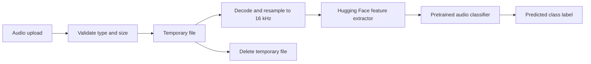

# Synthetic Speech Detection

A Flask prototype that accepts an audio upload and classifies it using the pretrained Hugging Face checkpoint `idolstranger/deepfake_audio_detection`.

This repository uses an external pretrained model for inference. It does not contain a training pipeline, dataset, independent evaluation, or verified accuracy results. Treat predictions as experimental; this project is not validated for authentication, fraud prevention, or other safety-critical decisions.

## Inference flow



The inference app is `api.py`. The separate `app.py` is a minimal upload-validation demo and does not run model inference.

## Requirements

- Python 3.10 or newer
- Internet access on first inference to download the Hugging Face model
- CPU inference is used by this implementation; compatible PyTorch installations may vary by operating system

## Run locally

Windows PowerShell:

```powershell
python -m venv .venv
.venv\Scripts\Activate.ps1
python -m pip install -r requirements.txt
python api.py
```

Linux/macOS:

```bash
python3 -m venv .venv
source .venv/bin/activate
python -m pip install -r requirements.txt
python api.py
```

Open `http://127.0.0.1:5000`. Upload a supported audio file (`.wav`, `.mp3`, `.flac`, `.m4a`, `.ogg`, or `.opus`) up to 16 MB. Audio is written to a temporary file for inference and removed afterward. The first model request may take longer while the model is downloaded and initialized.

## Tests

The route tests do not download or load the model; inference is replaced with a deterministic test double.

```bash
python -m pip install -r requirements-test.txt
python -m pytest -q
```

## Security and privacy

- Flask debug mode is disabled and the development server binds to localhost.
- Upload names are never used as filesystem paths; files use unique temporary names and are removed after the request.
- Upload size is limited to 16 MB and audio decoding is limited to 60 seconds before the classifier input is truncated or padded to five seconds.
- The upload form MIME type and extension are checked, but MIME type is supplied by the client and is not proof that a file is safe.
- Do not deploy this development server publicly without a production WSGI server, access controls, request limits, monitoring, and a retention review.

## Limitations

- The checkpoint is maintained by an external publisher; its provenance, licensing, training data, and performance characteristics should be reviewed before reuse.
- There is no local training or evaluation code in this repository, so no accuracy or robustness claim is made.
- Only the classifier's predicted label is shown; confidence calibration and explanation are not implemented.
- A model download or dependency failure returns a service-unavailable response. Model execution requires the external checkpoint and its runtime dependencies.

## Repository contents

```text
api.py                    Flask inference endpoint
app.py                    upload-validation-only demo
requirements.txt          inference dependencies
requirements-test.txt     lightweight test dependencies
tests/                    route and error-handling tests
.github/workflows/tests.yml
```
